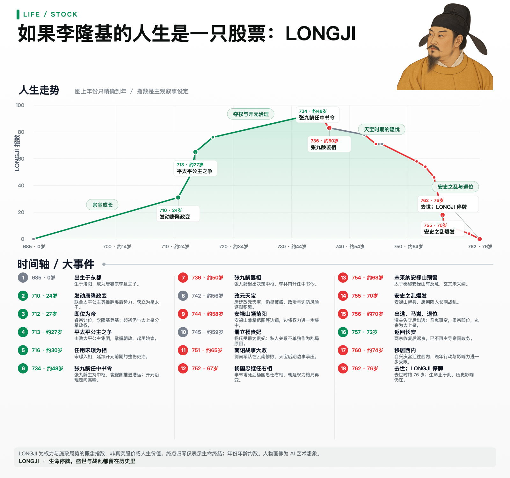
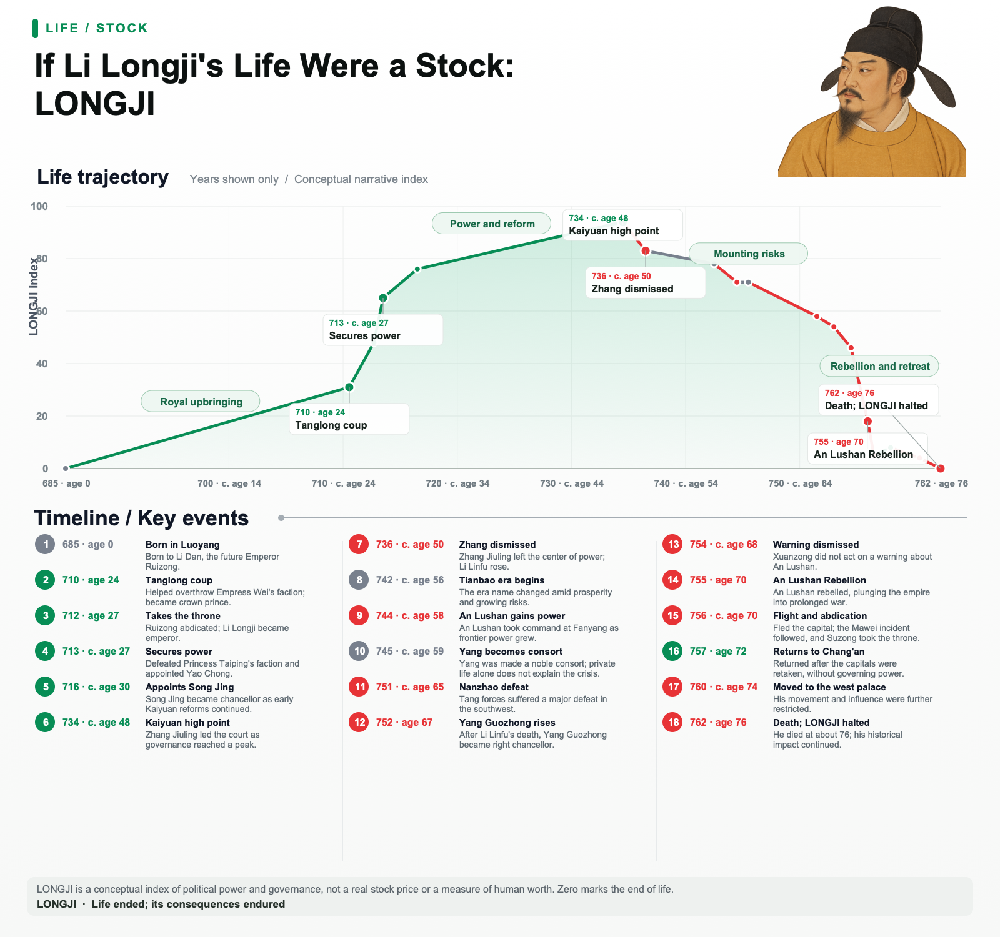

# Life Stock

Turn a documented life into a conceptual stock chart, an event timeline, and a short post in Chinese or English. The curve is an editorial metaphor for a stated angle, such as creative output or public influence. It is **not** a security price, a happiness score, or a measure of human worth.

Chinese chart: 

English chart: 

## Two ways to use it

**Prompt only:** Copy the [Chinese prompt](PROMPT.zh.md) or [English-chart prompt](PROMPT.en.md) into any agent that can research and create images. The result may vary with the agent's tools.

**Codex skill:** Clone this repository into your Codex skills directory:

```bash
git clone https://github.com/stephninja028-creator/life-stock.git ~/.codex/skills/life-stock
```

Then ask Codex, for example: `Use the life-stock skill to chart Mozart's life in English.` The [skill instructions](SKILL.md) ask the agent to verify events, choose no more than 25 meaningful nodes, render the chart, inspect it, and supply its sources. Shorter lives should use fewer nodes; 25 is a ceiling, not a target.

## Render the included example yourself

The deterministic SVG renderer requires Node.js 18 or newer. It does not require an API key. From the repository root:

```bash
node scripts/render.mjs examples/li-longji.json output/li-longji.svg
node scripts/render.mjs examples/li-longji.en.json output/li-longji.en.svg
```

On macOS, export a PNG with the included Swift/AppKit helper:

```bash
swift scripts/render_png.swift output/li-longji.svg output/li-longji.png
```

On other systems, open the SVG in a browser or export it with your preferred SVG tool. The SVG embeds any locally referenced portrait so the resulting file is self-contained.

Set `"locale": "en"` in the JSON for English chart labels and age notation; omit it or use `"zh"` for Chinese. The renderer does not translate event content, so provide event and period text in the chosen language.

The example includes [Chinese event data](examples/li-longji.json), [English event data](examples/li-longji.en.json), [historical source notes](examples/li-longji-research.md), and a [Chinese post](examples/li-longji-post.md). Its portrait is AI-generated artwork, not an authentic historical likeness. The preview and index values are illustrative; review sources and editorial judgments before reposting them.

## Design rules

- Show years only, followed by age at each displayed date. Mark an age as approximate when the source date is coarse.
- Use at most 25 meaningful events and no more than four labeled periods. Do not pad the timeline to fill the cap.
- Keep health, relationships, death, and other people's suffering distinct from moral approval or a person's value.
- Green, red, and gray describe the movement of the chosen conceptual index. A zero at death, if used, marks a lifespan boundary and does not erase influence.
- Keep factual labels and the curve editable in SVG. AI may generate an optional portrait, but should not invent dates or typeset the final chart.

## License

[MIT](LICENSE). Copyright © 2026 Zhang Mingliang.
